# QBudget — Class Diagram

Scope: the domain entities and the control (service) layer that operates on them.

**Assumptions.** Objects that pertain only to the GUI are not part of the class diagram — the React
pages, components and hooks in `frontend/src` are boundary objects, and the HTTP/JSON contract they
consume is represented by `ApiController`. The persistence layer is likewise excluded; see
*Excluded from the diagram* below for what was left out and where each piece is documented.

Source of truth: `backend/src/models.hpp` for the entities, `backend/src/*_service.hpp` and
`backend/src/api_controller.hpp` for the controls.

---

## Object Model

1. **Entities:** `UserProfile`, `Category`, `Transaction`, `CategoryBudget`, `SavingsGoal`,
   `CalendarEvent`, `RecurringEntry`, `Bursary`, `StudentFee`, `SemesterPlan`,
   `DisplayPreferences`, `ReminderSettings`, `NotificationPreferences`
2. **Controls:** `ApiController`, `AuthService`, `CategoryService`, `TransactionService`, `Ledger`,
   `BudgetService`, `GoalService`, `CalendarService`, `RecurrenceService`, `StudentService`,
   `ProfileService`, `SettingsService`, `ForecastService`, `NotificationService`
3. **Boundaries:** the React UI (excluded by the assumption above), and the Firebase Identity
   Toolkit and Firestore REST endpoints reached through the persistence layer

---

## Figure 1: Class diagram

All money is CAD integer cents (`MoneyCents` = `int64`); expenses are negative in the ledger. Dates
are ISO date-only strings wrapped in a `Date` value type.

```mermaid
classDiagram
    class UserProfile {
        <<Entity>>
        +fullName : string
        +studentId : optional~string~
    }
    class Category {
        <<Entity>>
        +id : string
        +name : string
        +custom : bool
        +archived : bool
    }
    class Transaction {
        <<Entity>>
        +id : string
        +date : Date
        +description : string
        +categoryId : string
        +type : TransactionType
        +amountCents : MoneyCents
        +note : string
        +recurrenceId : string
        +voided : bool
    }
    class CategoryBudget {
        <<Entity>>
        +id : string
        +categoryId : string
        +period : BudgetPeriod
        +amountCents : MoneyCents
    }
    class SavingsGoal {
        <<Entity>>
        +id : string
        +title : string
        +kind : GoalKind
        +targetCents : MoneyCents
    }
    class CalendarEvent {
        <<Entity>>
        +id : string
        +title : string
        +kind : string
        +date : Date
        +amountCents : MoneyCents
        +hasReminder : bool
        +paid : bool
    }
    class RecurringEntry {
        <<Entity>>
        +id : string
        +description : string
        +categoryId : string
        +type : TransactionType
        +amountCents : MoneyCents
        +startDate : Date
        +endDate : optional~Date~
        +frequency : RecurrenceFrequency
        +active : bool
    }
    class Bursary {
        <<Entity>>
        +id : string
        +name : string
        +amountCents : MoneyCents
        +status : BursaryStatus
    }
    class StudentFee {
        <<Entity>>
        +id : string
        +name : string
        +amountCents : MoneyCents
        +deadline : Date
        +status : FeeStatus
    }
    class SemesterPlan {
        <<Entity>>
        +startDate : Date
        +endDate : Date
        +expectedIncomeCents : MoneyCents
        +faculty : string
        +studentStatus : string
        +courseCount : int
        +tuitionPerCourseCents : MoneyCents
        +additionalFeesCents : MoneyCents
    }
    class DisplayPreferences {
        <<Entity>>
        +theme : string
        +currency : string
        +weekStart : string
        +dateFormat : string
    }
    class ReminderSettings {
        <<Entity>>
        +emailEnabled : bool
        +leadTime : string
    }
    class NotificationPreferences {
        <<Entity>>
        +paymentReminders : bool
        +forecastUpdates : bool
        +goalUpdates : bool
        +productAnnouncements : bool
    }

    class ApiController {
        <<Control>>
        -user : AuthenticatedUser
        -now : Date
        -cachedLedger : optional~Ledger~
        +handle(req) Json
        -ledger() Ledger
    }
    class AuthService {
        <<Control>>
        +authenticate(header) AuthenticatedUser
    }
    class CategoryService {
        <<Control>>
        +list(includeArchived) vector~Category~
        +find(id) Category
        +requireActive(id) void
        +create(name) string
        +remove(id) void
    }
    class TransactionService {
        <<Control>>
        +list(filter) vector~Transaction~
        +filterRecords(rows, filter) vector~Transaction~
        +create(value) string
        +update(id, value) void
        +remove(id) void
    }
    class Ledger {
        <<Control>>
        -records : vector~Transaction~
        -asOf : Date
        +totals(range) LedgerTotals
        +categorySpending(id, range) MoneyCents
        +breakdown(range, categories) vector~CategoryTotal~
        +points(range, granularity, income) vector~SeriesPoint~
    }
    class BudgetService {
        <<Control>>
        +list() vector~CategoryBudget~
        +set(budget) void
        +remove(id) void
        +summaries(ledger, now) vector~BudgetSummary~
    }
    class GoalService {
        <<Control>>
        +create(goal) string
        +update(id, goal) void
        +remove(id) void
        +progress(ledger, now) vector~GoalProgress~
    }
    class CalendarService {
        <<Control>>
        +list(range) vector~CalendarEvent~
        +upcoming(now) vector~UpcomingEvent~
        +create(event) string
        +update(id, event) void
        +remove(id) void
    }
    class RecurrenceService {
        <<Control>>
        +list() vector~RecurringEntry~
        +create(entry) string
        +update(id, entry) void
        +remove(id) void
        +occurrences(entry, range) vector~Date~
        +sync(now) int
    }
    class StudentService {
        <<Control>>
        +listBursaries() vector~Bursary~
        +addBursary(value) string
        +removeBursary(id) void
        +listFees() vector~StudentFee~
        +addFee(value) string
        +removeFee(id) void
        +plan(now) SemesterPlan
        +savePlan(value) void
        +summary(now, events) SemesterSummary
    }
    class ProfileService {
        <<Control>>
        +get(identity) UserProfile
        +update(value) UserProfile
    }
    class SettingsService {
        <<Control>>
        +display() DisplayPreferences
        +saveDisplay(value) void
        +reminders() ReminderSettings
        +saveReminders(value) void
        +notifications() NotificationPreferences
        +saveNotifications(value) void
    }
    class ForecastService {
        <<Control>>
        +forecast(ledger, events, recurring, now, months) vector~ForecastMonth~
        +series(months, now, granularity) vector~SeriesPoint~
    }
    class NotificationService {
        <<Control>>
        +list(now, events, budgets, reminders, preferences) vector~AppNotification~
    }

    AuthService ..> ApiController : verified identity

    ApiController *-- CategoryService
    ApiController *-- TransactionService
    ApiController *-- BudgetService
    ApiController *-- GoalService
    ApiController *-- CalendarService
    ApiController *-- RecurrenceService
    ApiController *-- StudentService
    ApiController *-- ProfileService
    ApiController *-- SettingsService
    ApiController *-- ForecastService
    ApiController *-- NotificationService
    ApiController "1" *-- "0..1" Ledger : caches per request

    TransactionService o-- CategoryService
    BudgetService o-- CategoryService
    RecurrenceService o-- CategoryService
    BudgetService ..> Ledger : reads spending
    GoalService ..> Ledger : reads totals
    ForecastService ..> Ledger : reads baseline
    ForecastService ..> RecurrenceService : occurrences
    NotificationService ..> CalendarService
    NotificationService ..> BudgetService
    StudentService ..> CalendarService : scheduled costs

    Ledger o-- Transaction
    CategoryService ..> Category
    TransactionService ..> Transaction
    BudgetService ..> CategoryBudget
    GoalService ..> SavingsGoal
    CalendarService ..> CalendarEvent
    RecurrenceService ..> RecurringEntry
    RecurrenceService ..> Transaction : generates
    StudentService ..> Bursary
    StudentService ..> StudentFee
    StudentService ..> SemesterPlan
    ProfileService ..> UserProfile
    SettingsService ..> DisplayPreferences
    SettingsService ..> ReminderSettings
    SettingsService ..> NotificationPreferences

    UserProfile "1" --> "0..*" Transaction : owns
    UserProfile "1" --> "0..*" Category : owns custom
    UserProfile "1" --> "0..*" CategoryBudget : owns
    UserProfile "1" --> "0..*" SavingsGoal : owns
    UserProfile "1" --> "0..*" CalendarEvent : owns
    UserProfile "1" --> "0..*" RecurringEntry : owns
    UserProfile "1" --> "0..*" Bursary : owns
    UserProfile "1" --> "0..*" StudentFee : owns
    UserProfile "1" --> "1" SemesterPlan : plans
    UserProfile "1" --> "1" DisplayPreferences : configures
    UserProfile "1" --> "1" ReminderSettings : configures
    UserProfile "1" --> "1" NotificationPreferences : configures

    Category "1" --> "0..*" Transaction : classifies
    Category "1" --> "0..3" CategoryBudget : limits per period
    Category "1" --> "0..*" RecurringEntry : classifies
    RecurringEntry "1" --> "0..*" Transaction : generates
    SemesterPlan "1" --> "0..*" StudentFee : scopes by deadline
    SemesterPlan "1" --> "0..*" Bursary : funds
```

---

## Excluded from the diagram

These exist in the implementation but carry no design decision, so showing them would roughly
double the diagram without adding information.

| Excluded | Why | Documented in |
| --- | --- | --- |
| `DocumentStore`, `Repository<T>` and its 8 subclasses, `ProfileRepository`, `SettingsRepository`, `FirestoreClient` | The subclasses only bind `Repository<T>` to a record type and a collection name; the storage layout is a data concern | `docs/data-model.md`, `backend/src/repositories.hpp` |
| `LedgerTotals`, `CategoryTotal`, `SeriesPoint`, `BudgetSummary`, `GoalProgress`, `UpcomingEvent`, `ForecastMonth`, `SemesterSummary`, `TransactionFilter` | Transient calculation results, not stored records — they appear above as operation return types | `backend/src/models.hpp` |
| `TransactionType`, `BudgetPeriod`, `GoalKind`, `RecurrenceFrequency`, `BursaryStatus`, `FeeStatus` | Enumerations, shown above as attribute types | `backend/src/models.hpp` |
| `Date`, `DateRange` | Value types wrapping ISO date strings, shown above as attribute types | `backend/src/date.hpp` |
| `HttpServer`, `Transport`, `HttpResult`, `ApiError` | HTTP plumbing and error transport, not domain design | `backend/src/main.cpp`, `backend/src/http_transport.hpp` |
| `MemoryStore` | Unit-test double substituted for `DocumentStore` | `backend/tests/memory_store.hpp` |
| `AuthenticatedUser`, `AppNotification` | Request-scoped identity and generated notifications; neither is a stored record | `backend/src/models.hpp` |

Each settings entity is stored as its own document — `settings/display`, `settings/reminders` and
`settings/notifications` — which is why `SettingsService` exposes a separate accessor pair for each.

---

## Design notes behind the structure

- **Per-request `ApiController`.** It is constructed with the identity `AuthService` verified from
  the bearer token, owns every service for that request, and caches one `Ledger`. Ownership never
  comes from a client-supplied field, and no cache outlives the request.
- **One persistence seam.** Services reach storage only through repositories over the
  `DocumentStore` interface, so no service depends on Firebase or on JSON, and the tests substitute
  an in-memory store.
- **Calculated values are not entities.** Totals, budget summaries, goal progress and forecasts are
  recomputed from the ledger on each request rather than stored, which is what keeps them from
  going stale.
- **Soft deletion where references matter.** Removing a custom `Category` archives it so historical
  transactions keep their label, and deleting a generated `Transaction` sets `voided` so
  `RecurrenceService.sync()` cannot regenerate it.
